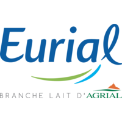

---
title: "About"
description-meta: "Freelance Data Analyst based in Nantes. Exploratory data analysis, Power BI dashboards, decision-making modeling."
lang: en
navbar:
  left:
    - href: index.en.qmd
      text: "About"
    - href: projects.en.qmd
      text: "Projects"
  right:
    - icon: globe
      menu:
        - text: "Français"
          href: index.qmd
        - text: "English"
          href: index.en.qmd
---

:::: {.columns}

::: {.column width="30%"}
{.rounded-circle fig-alt="Photo of Agnès Drouard" width="100%"}
:::

::: {.column width="5%"}
<!-- Espace de séparation -->
:::

::: {.column width="65%"}
Agnès Drouard

## About me

Industry-focused Data Analyst with 10 years of experience in supply chain and quality (procurement, production scheduling, traceability, raw-material risk), I turn your production and logistics data into reliable decision-making tools. 
:::

::::

Having dealt with these challenges firsthand, I understand the realities of the business. I have built and automated raw-material risk databases and set up supply chain KPIs (procurement and production scheduling for around ten plants). 

## Skills

- **Data transformation**: SQL, dbt, Snowflake
- **BI**: Power BI, Power Query, DAX
- **Analysis & automation**: Python (Pandas, NumPy, Matplotlib), Jupyter, Excel (advanced, PivotTables, VBA)
- **Cloud & versioning**: AWS (Lambda, SQS), Git

## Professional Experience

::: {.mb-5}
::: {.d-flex .align-items-center .gap-3 .mb-1}
{width="55px" fig-alt="Strapp Mobile Logo" .my-auto}

::: {.d-flex .flex-column .justify-content-center}
### Data Analyst - Strapp Mobile {.h4 .m-0 .fw-bold .lh-1}
[*Internship · March 2026 - April 2026*]{.text-muted .mt-1 .mb-0 .fs-6 .lh-1}
:::
:::

- **Statistical modeling and scoring (Jupyter) :** applied a multi-criteria methodology (AHP – Analytic Hierarchy Process) to score data usage and automate mobile plan recommendations
- **Cloud deployment (AWS) :** Python scripts (GitLab) connected to MongoDB, automating data processing via Lambda and SQS
:::

::: {.mb-5}
::: {.d-flex .align-items-center .gap-3 .mb-1}
{width="55px" fig-alt="Val Nantais Logo" .my-auto}

::: {.d-flex .flex-column .justify-content-center}
### Supply Manager - Val Nantais {.h4 .m-0 .fw-bold .lh-1}
[*Permanent contract · July 2024 - November 2024*]{.text-muted .mt-1 .mb-0 .fs-6 .lh-1}
:::
:::

- Analyzed supply requirements and modeled schedules based on contractual and operational constraints
- Monitored performance indicators (lead times, disputes, costs)
- Coordinated flows (transport, packaging) and off-contract purchasing
:::

::: {.mb-5}
::: {.d-flex .align-items-center .gap-3 .mb-1}
{width="55px" fig-alt="Eurial Logo" .my-auto}

::: {.d-flex .flex-column .justify-content-center}
### Scheduling Manager - Eurial {.h4 .m-0 .fw-bold .lh-1}
[*Permanent contract · February 2021 - June 2024*]{.text-muted .mt-1 .mb-0 .fs-6 .lh-1}
:::
:::

- Developed a supply performance indicator and modeled optimization scenarios (6-month project)
- Built and monitored the weekly supply program (analysis of volumes, constraints, and variances)
- Monitored volume swap agreements and analyzed variances
- On-call rotation for scheduling and transport operations
:::

::: {.mb-5}
::: {.d-flex .align-items-center .gap-3 .mb-1}
{width="55px" fig-alt="LDC Logo" .my-auto}

::: {.d-flex .flex-column .justify-content-center}
### Quality Assistant - LDC Traiteur {.h4 .m-0 .fw-bold .lh-1}
[*Permanent contract · October 2014 - April 2019*]{.text-muted .mt-1 .mb-0 .fs-6 .lh-1}
:::
:::

- Performed functional testing of the internal raw-material management software
- Managed supplier and raw-material data
- Conducted supplier audits and monitored quality indicators
:::

## Get in touch

Have a data analysis project, a question about my work, or a collaboration opportunity?

::: {.callout-note appearance="minimal"}
<i class="bi bi-geo-alt-fill"></i> Nantes & Remote  
<i class="bi bi-envelope-fill"></i> [agnesdrouard90@gmail.com](mailto:agnesdrouard90@gmail.com)  
<i class="bi bi-linkedin"></i> [LinkedIn](https://www.linkedin.com/in/agnes-drouard/)  
<i class="bi bi-github"></i> [GitHub](https://github.com/AniessD)  
<svg xmlns="http://www.w3.org/2000/svg" width="16" height="16" fill="currentColor" viewBox="0 0 24 24" style="vertical-align: -0.125em;">
  <path d="M12 0L1.5 6v12L12 24l10.5-6V6L12 0zm0 3.21l7.5 4.29v8.57L12 20.36l-7.5-4.29V7.5L12 3.21z"/>
</svg> [Malt](https://www.malt.fr/profile/agnesdrouard)
:::

---

