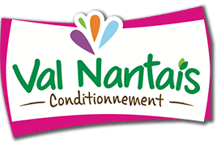
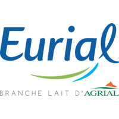

---
title: "About"
description-meta: "Freelance Data Analyst based in Nantes. Exploratory data analysis, Power BI dashboards, decision-making modeling."
lang: en
navbar:
  left:
    - href: index.en.qmd
      text: "About"
    - href: projects.en.qmd
      text: "Projects"
  right:
    - icon: globe
      menu:
        - text: "Français"
          href: index.qmd
        - text: "English"
          href: index.en.qmd
---

:::: {.columns}

::: {.column width="30%"}
{.rounded-circle fig-alt="Photo of Agnès Drouard" width="100%"}
:::

::: {.column width="5%"}
<!-- Espace de séparation -->
:::

::: {.column width="65%"}
Agnès Drouard

## About me

Industry-focused Data Analyst with 10 years of experience in supply chain and quality (procurement, production scheduling, traceability, raw-material risk), I turn your production and logistics data into reliable decision-making tools. 
:::

::::

Having dealt with these challenges firsthand, I understand the realities of the business. I have built and automated raw-material risk databases and set up supply chain KPIs (procurement and production scheduling for around ten plants). 

## Get in touch

Have a data analysis project, a question about my work, or a collaboration opportunity?

::: {.callout-note appearance="minimal"}
<i class="bi bi-geo-alt-fill"></i> Nantes & Remote  
<i class="bi bi-envelope-fill"></i> [agnesdrouard90@gmail.com](mailto:agnesdrouard90@gmail.com)  
<i class="bi bi-linkedin"></i> [LinkedIn](https://www.linkedin.com/in/agnes-drouard/)  
<i class="bi bi-github"></i> [GitHub](https://github.com/AniessD)  
<svg xmlns="http://www.w3.org/2000/svg" width="16" height="16" fill="currentColor" viewBox="0 0 24 24" style="vertical-align: -0.125em;">
  <path d="M12 0L1.5 6v12L12 24l10.5-6V6L12 0zm0 3.21l7.5 4.29v8.57L12 20.36l-7.5-4.29V7.5L12 3.21z"/>
</svg> [Malt](https://www.malt.fr/profile/agnesdrouard)
:::

## Skills

- **Data transformation**: SQL, dbt, Snowflake
- **BI**: Power BI, Power Query, DAX
- **Analysis & automation**: Python (Pandas, NumPy, Matplotlib), Jupyter, Excel (advanced, PivotTables, VBA)
- **Cloud & versioning**: AWS (Lambda, SQS), Git

## Professional Experience

::: {.mb-5}
::: {.d-flex .align-items-center .gap-3 .mb-1}
{width="55px" fig-alt="Strapp Mobile Logo" .my-auto}

::: {.d-flex .flex-column .justify-content-center}
### Data Analyst - Strapp Mobile {.h4 .m-0 .fw-bold .lh-1}
[*Internship · March 2026 - April 2026*]{.text-muted .mt-1 .mb-0 .fs-6 .lh-1}
:::
:::

- **Statistical modeling and scoring (Jupyter) :** applied a multi-criteria methodology (AHP – Analytic Hierarchy Process) to score data usage and automate mobile plan recommendations
- **Cloud deployment (AWS) :** Python scripts (GitLab) connected to MongoDB, automating data processing via Lambda and SQS
:::

::: {.mb-5}
::: {.d-flex .align-items-center .gap-3 .mb-1}
{width="55px" fig-alt="Val Nantais Logo" .my-auto}

::: {.d-flex .flex-column .justify-content-center}
### Supply Manager - Val Nantais {.h4 .m-0 .fw-bold .lh-1}
[*Permanent contract · July 2024 - November 2024*]{.text-muted .mt-1 .mb-0 .fs-6 .lh-1}
:::
:::

- Analyzed supply requirements and modeled schedules based on contractual and operational constraints
- Monitored performance indicators (lead times, disputes, costs)
- Coordinated flows (transport, packaging) and off-contract purchasing
:::

::: {.mb-5}
::: {.d-flex .align-items-center .gap-3 .mb-1}
{width="55px" fig-alt="Eurial Logo" .my-auto}

::: {.d-flex .flex-column .justify-content-center}
### Scheduling Manager - Eurial {.h4 .m-0 .fw-bold .lh-1}
[*Permanent contract · February 2021 - June 2024*]{.text-muted .mt-1 .mb-0 .fs-6 .lh-1}
:::
:::

- Developed a supply performance indicator and modeled optimization scenarios (6-month project)
- Built and monitored the weekly supply program (analysis of volumes, constraints, and variances)
- Monitored volume swap agreements and analyzed variances
- On-call rotation for scheduling and transport operations
:::

::: {.mb-5}
::: {.d-flex .align-items-center .gap-3 .mb-1}
{width="55px" fig-alt="LDC Logo" .my-auto}

::: {.d-flex .flex-column .justify-content-center}
### Quality Assistant - LDC Traiteur {.h4 .m-0 .fw-bold .lh-1}
[*Permanent contract · October 2014 - April 2019*]{.text-muted .mt-1 .mb-0 .fs-6 .lh-1}
:::
:::

- Performed functional testing of the internal raw-material management software
- Managed supplier and raw-material data
- Conducted supplier audits and monitored quality indicators
:::

## Certifications

::: {.mb-4}
::: {.d-flex .align-items-center .gap-3 .mb-1}
{width="55px" fig-alt="Microsoft logo" .my-auto}

::: {.d-flex .flex-column .justify-content-center}
### [Microsoft Certified: Power BI Data Analyst Associate (PL-300)](https://learn.microsoft.com/api/credentials/share/en-us/AgnsDrouard-7394/E4DED5AC3B472D3B?sharingId=D6319BD3198A0AAA) {.h4 .m-0 .fw-bold .lh-1}
[*Microsoft · June 2026*]{.text-muted .mt-1 .mb-0 .fs-6 .lh-1}
:::
:::
:::

::: {.mb-4}
::: {.d-flex .align-items-center .gap-3 .mb-1}
{width="55px" fig-alt="OpenClassrooms logo" .my-auto}

::: {.d-flex .flex-column .justify-content-center}
### Data Analyst, RNCP Level 6 Certification (equivalent to a Bachelor's degree) {.h4 .m-0 .fw-bold .lh-1}
[*OpenClassrooms · September 2026*]{.text-muted .mt-1 .mb-0 .fs-6 .lh-1}
:::
:::
:::

## Recommandations

:::: {.reco-grid}

::: {.reco-card}
::: {.d-flex .align-items-start .justify-content-between .gap-3 .mb-2}

**Charles RAMES**  
[*Direct manager at Strapp Mobile*]{.text-muted .fs-6}

{width="22px" fig-alt="Recommandation Malt"}
:::

::: {.reco-text}
I had the pleasure of supervising Agnès during her Data Analyst internship at Strapp, and I recommend her without the slightest hesitation.  
What stands out first is her autonomy and how quickly she learns: having only recently changed careers, she mastered our tools and topics in record time,  
even building a working methodology herself where no framework existed.  
Rigorous and reliable, she delivered consistently high-quality analyses that the team could rely on day to day.  
Agnès also has excellent interpersonal skills: she is attentive and communicates clearly, and she knows how to bring both business and technical teams on board and move topics forward.  
Curious, demanding of herself and always improving, she has everything it takes to succeed in a data role or assignment.  
Any team that works with her will have made an excellent choice!  
:::
:::

::: {.reco-card}
::: {.d-flex .align-items-start .justify-content-between .gap-3 .mb-2}

**Jérôme TOMASZEWSKI**  
[*Direct manager at Eurial*]{.text-muted .fs-6}

{width="22px" fig-alt="Recommandation LinkedIn"}
:::

::: {.reco-text}
I had the pleasure of managing Agnès for more than 3 years at Eurial.   
Thanks to her deep understanding of supply chain challenges and her analytical rigor, she developed service performance indicators and modeled optimization scenarios that were key to our business.
Agnès has the ability to juggle day-to-day operational management with the perspective needed to build reliable, lasting steering tools.  
I recommend Agnès for any data analysis and process optimization assignment. 
:::
:::

::: {.reco-card}
::: {.d-flex .align-items-start .justify-content-between .gap-3 .mb-2}

**Stéphane LEMESLE**  
[*Direct manager at Eurial*]{.text-muted .fs-6}

{width="22px" fig-alt="Recommandation LinkedIn"}
:::

::: {.reco-text}
I had the pleasure of working with Agnès at Eurial, where I came to appreciate her excellent work, her rigor, her curiosity, and her ease in solving problems.  
It is therefore with confidence that I recommend Agnès. You will benefit from her experience and her qualities as a true professional, so don't hesitate: get in touch with her!  
:::
:::

::: {.reco-card}
::: {.d-flex .align-items-start .justify-content-between .gap-3 .mb-2}

**Manuela GOURICHON**  
[*Direct manager at LDC Traiteur*]{.text-muted .fs-6}

{width="22px" fig-alt="Recommandation LinkedIn"}
:::

::: {.reco-text}
Agnès is a brilliant young woman who knows how to listen carefully and adapt very precisely to your needs.  
You can trust her completely: working with her, you will only ever come away satisfied.  
:::
:::

::: {.reco-card}
::: {.d-flex .align-items-start .justify-content-between .gap-3 .mb-2}

**Alexandra VANHUYSBERGHE**  
[*Direct manager at LDC Traiteur*]{.text-muted .fs-6}

{width="22px" fig-alt="Recommandation LinkedIn"}
:::

::: {.reco-text}
I had the pleasure of working with Agnès for several years in the Quality team, which she joined as a young engineer.  
She is very comfortable with IT tools and quickly became the team's go-to person on these topics. She developed and evolved many quality applications, always starting from users' real needs.  
She played a key role in setting up and rolling out our supplier specifications management platform. This project connected all of our suppliers and consolidated the specifications into a model dedicated to each product family. On this demanding, multi-year data structuring project, I could count on her from start to finish.  
Rigorous, pragmatic and attentive, Agnès knows how to understand a business before proposing a solution. She is a reliable and trustworthy professional.  
I'm delighted to see her starting out as a freelance Data Analyst. I recommend her without hesitation!  
:::
:::

::: {.reco-card}
::: {.d-flex .align-items-start .justify-content-between .gap-3 .mb-2}

**Maëva BEAULIEU**  
[*Colleague at Eurial*]{.text-muted .fs-6}

{width="22px" fig-alt="Recommandation LinkedIn"}
:::

::: {.reco-text}
Working with Agnès was a real pleasure. In addition to her technical skills, she knows how to build a relationship of trust  
and adapt to the needs of the people she works with. Her commitment and her sense of service make all the difference.  
I highly recommend her services.  
:::
:::

::::

---

