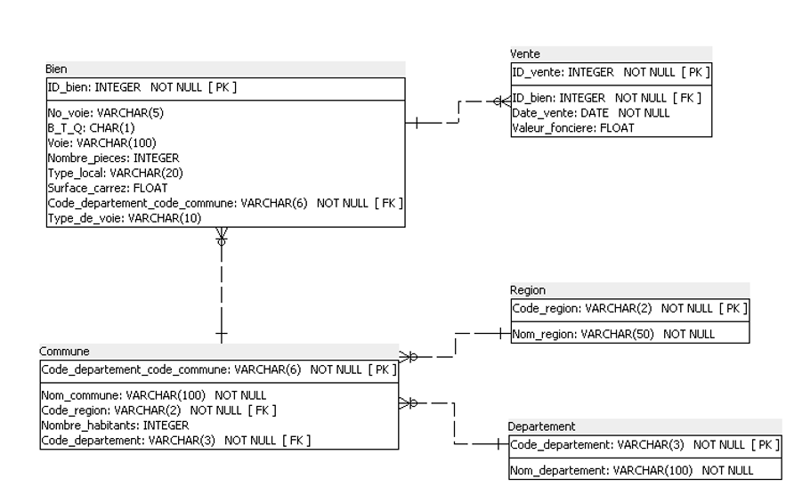
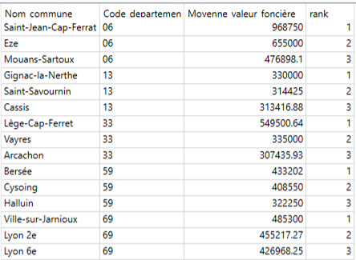

## Context

This project was carried out as part of my Data Analyst training at OpenClassrooms.

## Approach

1. Data Analysis  

- Identification of relevant columns  
- Data cleaning and standardization  
- Creation of the data dictionary  

2. Relational Schema Design  

- 3NF Normalization  
- Primary and foreign keys definition  
- Cardinality management  

3. SQLite Database Creation  

- Table creation  
- CSV imports  
- Error handling and resolution  

4. SQL Queries  

- Aggregations  
- Multiple JOINs  
- Subqueries  
- Window functions (RANK)  

## Key Results

Examples of analyses performed:  

- Number of apartment sales by region  
- Distribution of apartment sales by number of rooms  
- Top 10 departments with the highest price per m²  
- List of municipalities with at least 50 sales  
- Average property value for the top 3 municipalities per department  

## Key Deliverables

{fig-align="center" fig-alt="Relational schema"}

<details>
<summary><b> Top 3 highest average property values by municipality (departments 06, 13, 33, 59, and 69) (SQL)</b></summary>

```sql

SELECT * 
FROM (
    SELECT *,
        RANK() OVER (
            PARTITION BY join2.Code_departement
            ORDER BY join2.Moyenne_Valeur_Foncière DESC
        ) AS rank
    FROM (
        SELECT 
            c.Nom_commune, 
            c.Code_departement,
            ROUND(AVG(join1.Valeur_fonciere), 2) AS Moyenne_valeur_foncière
        FROM (
            SELECT * 
            FROM Bien b 
            JOIN Vente v ON b.ID_bien = v.ID_bien
        ) join1
        JOIN Commune c 
            ON c.Code_departement_code_commune = join1.COde_departement_code_commune
        WHERE c.Code_departement IN ('06', '13', '33', '59', '69')
        GROUP BY c.Nom_commune
    ) join2
) 
WHERE rank <= 3;

```
</details>

{fig-align="center" fig-alt="Résultat requête"}

## Tech Stack

`SQL`


[View full project on GitHub →](https://github.com/AniessD/OC_sql_BDD_immo)  
[Back to projects list →](../projects.qmd)
