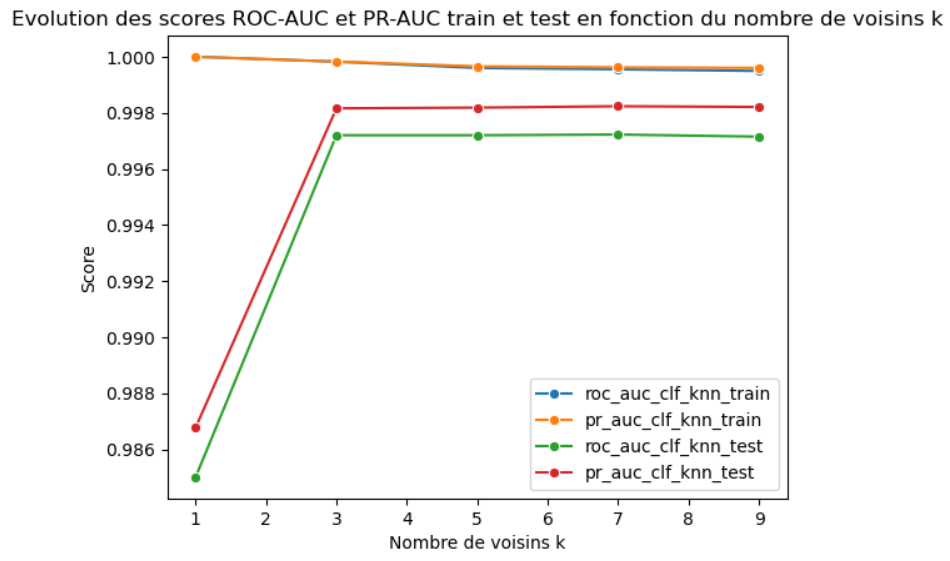

## Context

This project was carried out as part of my Data Analyst training at OpenClassrooms.

## Approach

1. Exploratory data analysis
- Univariate analysis (distributions, outliers using z-score and IQR)
- Multivariate analysis (correlations between variables, Mann-Whitney tests)

Based on this initial analysis, 3 variables appear to be the most discriminating for detecting counterfeit banknotes: bottom margin, top margin and length.

2. Preprocessing

- Train/test split of the dataset (80/20)
- Imputation of missing values (mean by banknote type, as less than 2.5% of values were missing)
- Data standardization

3. Model testing

- Logistic regression (supervised model)
- KNN (supervised model)
- Random forest (supervised model)
- K-means (unsupervised model)

For each model, results are first analyzed with a confusion matrix (provisional, since the threshold t has not been set at this stage). The best supervised model is then selected by comparing ROC-AUC and PR-AUC scores. This model is tuned by comparing its results at different thresholds t. Finally, it is compared with the unsupervised K-means model using Accuracy, Precision, Recall and F1 scores.

4. Building the application
- Export of the full pipeline (preprocessing + model) as a .joblib file
- Creation of a .py script that loads the .joblib file
- 2 ways to use it:
    - analyze a single banknote by entering its measurements directly
    - analyze several banknotes from a .csv file

## Key Results

The best supervised model for this project is logistic regression, with a ROC-AUC score of **99.96%** and a PR-AUC score of **99.98%** on the test set. It also outperforms the unsupervised model (K-means), which achieves accuracy: **99.33%**, precision: **99.5%**, recall: **99.5%** and F1 score: **99.5%**.

## Key Deliverables

<details>
<summary><b> KNN model evaluation by number of neighbors k</b></summary>

```python
# Train the model while varying the number of neighbors k

roc_auc_clf_knn_train_scores = []
pr_auc_clf_knn_train_scores = []
roc_auc_clf_knn_test_scores = []
pr_auc_clf_knn_test_scores = []

neighbors = range(1,11,2)

for k in neighbors :
    
    clf_knn = KNeighborsClassifier(n_neighbors=k).fit(X_train_scaled, y_train)

    # Predict probabilities
    y_train_pred_proba = clf_knn.predict_proba(X_train_scaled)[:, 1]
    y_test_pred_proba = clf_knn.predict_proba(X_test_scaled)[:, 1]

    # Compute ROC-AUC and PR-AUC scores
    roc_auc_clf_knn_train = roc_auc_score(y_train, y_train_pred_proba)
    pr_auc_clf_knn_train = average_precision_score(y_train, y_train_pred_proba)
    roc_auc_clf_knn_test = roc_auc_score(y_test, y_test_pred_proba)
    pr_auc_clf_knn_test = average_precision_score(y_test, y_test_pred_proba)

    roc_auc_clf_knn_train_scores.append(roc_auc_clf_knn_train)
    pr_auc_clf_knn_train_scores.append(pr_auc_clf_knn_train)
    roc_auc_clf_knn_test_scores.append(roc_auc_clf_knn_test)
    pr_auc_clf_knn_test_scores.append(pr_auc_clf_knn_test)

sns.lineplot(x = neighbors, y = roc_auc_clf_knn_train_scores, marker = 'o', label = 'roc_auc_clf_knn_train')
sns.lineplot(x = neighbors, y = pr_auc_clf_knn_train_scores, marker = 'o', label = 'pr_auc_clf_knn_train')
sns.lineplot(x = neighbors, y = roc_auc_clf_knn_test_scores, marker = 'o', label = 'roc_auc_clf_knn_test')
sns.lineplot(x = neighbors, y = pr_auc_clf_knn_test_scores, marker = 'o', label = 'pr_auc_clf_knn_test')

plt.legend()
plt.title('Evolution des scores ROC-AUC et PR-AUC train et test en fonction du nombre de voisins k')
plt.xlabel('Nombre de voisins k')
plt.ylabel('Score')
plt.show()

```
</details>

{fig-align="center" fig-alt="KNN model evaluation by number of neighbors k"}

<details>
<summary><b> Function for predicting several banknotes in the application</b></summary>

```python
def predire_plusieurs_billets(pipeline,lien_csv):
    
    with open(lien_csv, 'r', encoding='utf-8') as f:
        premiere_ligne = f.readline()
        
    separateur = ';' if ';' in premiere_ligne else ','
    
    X_raw = pd.read_csv(lien_csv, sep=separateur)

    colonnes_attendues = ["diagonal", "height_left", "height_right", "margin_low", "margin_up", "length"]

    X_filled = X_raw.dropna(subset=colonnes_attendues)

    nb_lignes_supp = X_raw.shape[0] - X_filled.shape[0]
    
    if nb_lignes_supp > 0 : 
        print(f"\nAttention : {nb_lignes_supp} billet(s) du fichier csv contienne(nt) des valeurs manquantes. Il n'est pas possible de détecter si ce(s) billet(s) sont vrai(s) ou faux. Il(s) a/ont donc été supprimé(s) du tableau de résultats.\n")

    X = X_filled[colonnes_attendues]

    y = pipeline.predict(X)

    df_resultat = X_filled.copy()
    df_resultat['Résultat_binaire'] = y
    df_resultat['Résultat'] = df_resultat['Résultat_binaire'].map({False : "Faux billet", True : 'Vrai billet'})

    return df_resultat


```
</details>

## Tech Stack

`python` · `Jupyter` · `Machine Learning`


[View the full project on GitHub →](https://github.com/AniessD/OC_script_detection_faux_billets)  
[Back to projects →](../projects.qmd)
