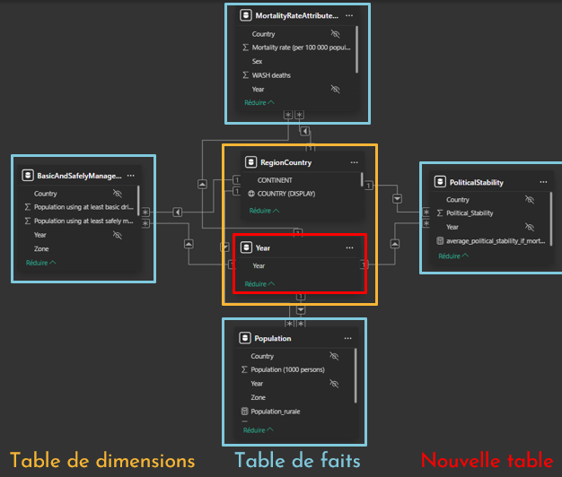

## Context

This project was carried out as part of my Data Analyst training at OpenClassrooms.

## Approach

The dashboard has 3 main pages:

1. Global
- Global KPI showing the number of deaths linked to unsafe water.
- Aggregated time-series charts for a macro-level comparison between continents.
- Dynamic world map.

2. Continent
- Qualitative segmentation by Political Stability ("Stable country" / "Unstable country").
- Combined histogram showing the distribution of water access by country according to population size.
- Scatter plot crossing political stability and water policy effectiveness.

3. Country
- Mortality rate breakdown by gender.
- Analysis of the evolution over time (2000-2017) of "basic" vs "safely managed" services.
- Line and stacked bar charts differentiating access to water services in urban and rural areas.

## Key Results

The analysis led to the following conclusions:

- **870,000 people** died in 2016 as a result of consuming unsafe water
- **Africa** is the continent with the lowest percentages of access to water worldwide
- The United Republic of Tanzania had an average water-related mortality rate in 2016 of **38.4 per 100,000 inhabitants**

## Key Deliverables

{fig-align="center" fig-alt="Constellation schema"}

<details>
<summary><b> DAX measure calculating the average rate of access to basic drinking water services</b></summary>

```dax
average_basic_drinking_services_rate_if_mortality = 
CALCULATE(
    AVERAGE(BasicAndSafelyManagedDrinkingWaterServices[Population using at least basic drinking-water services (%)]),
    BasicAndSafelyManagedDrinkingWaterServices[Zone] = "Total",
    KEEPFILTERS(MortalityRateAttributedToWater)
)


```
</details>

## Tech Stack

`Power BI` · `DAX` · `Power Query`


[View the full project on GitHub →](https://github.com/AniessD/OC_power_BI_etude_eau_potable/)  
[Back to projects →](../projects.qmd)
