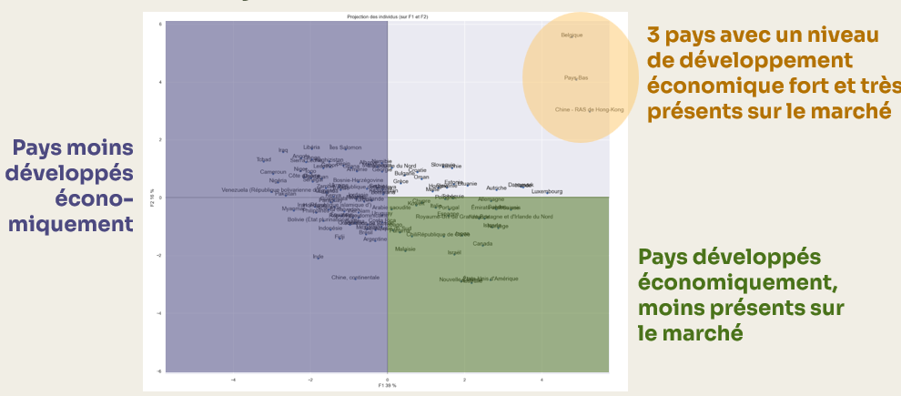

## Context

This project was carried out as part of my Data Analyst training at OpenClassrooms.

## Approach

Criteria analyzed:

- Political stability score
- Poultry meat consumption (kg/person/year)
- Export rate
- Import dependency rate
- Population
- GDP per capita
- Logistics performance index
- Distance from France (in km)
- Ease of doing business score

After cleaning and joining, the final dataset covers 117 countries and 86% of the world population (in 2017).

1. Data preparation and cleaning

- Data extraction
- Data cleaning
- Univariate analysis
- Study of correlations between variables

2. Principal component analysis (PCA)

- Data standardization
- Scree plot of eigenvalues
- Analysis of the correlation circle
- Projection of individuals onto factorial planes

3. Clustering

- K-means
- Hierarchical agglomerative clustering (HAC)
- Visualization and analysis of clusters
- Comparison of clusters using a contingency matrix

## Key Results

The analysis identified 2 groups of countries to prioritize for the company:

- **Logistics hubs (Belgium, Hong Kong, Netherlands)**: major commercial transit zones with very high export and import rates
- **Premium nearby markets**: economically stable countries close to France, with an import dependency rate close to 50%

A differentiated commercial strategy is recommended depending on the targeted countries.

## Key Deliverables

<details>
<summary><b> Function displaying the projection of individuals</b></summary>

```python
# Function displaying the projection of individuals
def display_factorial_planes(   X_projected, 
                                x_y, 
                                pca=None, 
                                labels = None,
                                clusters=None, 
                                alpha=1,
                                figsize=[10,8], 
                                marker="." ):
    """
    Displays the projection of individuals

    Positional arguments : 
    -------------------------------------
    X_projected : np.array, pd.DataFrame, list of list : matrix of projected points
    x_y : list or tuple : the x,y pair of planes to display, e.g. [0,1] for F1, F2

    Optional arguments : 
    -------------------------------------
    pca : sklearn.decomposition.PCA : a fitted PCA object, used to display the variance of each component, default = None
    labels : list or tuple : labels of the individuals to project, default = None
    clusters : list or tuple : list of the clusters each individual belongs to, default = None
    alpha : float in [0,1] : transparency parameter, 0=100% transparent, 1=0% transparent, default = 1
    figsize : list or tuple : width, height pair defining the figure size in inches, default = [10,8] 
    marker : str : marker type used to represent individuals, dots, crosses, etc., default = "."
    """

    # Convert X_projected to np.array
    X_ = np.array(X_projected)

    # Handle labels
    if  labels is None : 
        labels = []
    try : 
        len(labels)
    except Exception as e : 
        raise e

    # Check the axis variable
    if not len(x_y) ==2 : 
        raise AttributeError("2 axes sont demandées")   
    if max(x_y )>= X_.shape[1] : 
        raise AttributeError("la variable axis n'est pas bonne")   

    # Define x and y
    x, y = x_y

    # Initialize the figure       
    fig, ax = plt.subplots(1, 1, figsize=figsize)

    # Check whether there are clusters
    c = None if clusters is None else clusters
 
    # Points    
    # plt.scatter(   X_[:, x], X_[:, y], alpha=alpha, 
    #                     c=c, cmap="Set1", marker=marker)
    sns.scatterplot(data=None, x=X_[:, x], y=X_[:, y], hue=c)

    # If a pca was provided, compute the % of variance of each axis
    if pca : 
        v1 = str(round(100*pca.explained_variance_ratio_[x]))  + " %"
        v2 = str(round(100*pca.explained_variance_ratio_[y]))  + " %"
    else : 
        v1=v2= ''

    # Axis names, with the percentage of inertia explained
    ax.set_xlabel(f'F{x+1} {v1}')
    ax.set_ylabel(f'F{y+1} {v2}')

    # Max x and y values
    x_max = np.abs(X_[:, x]).max() *1.1
    y_max = np.abs(X_[:, y]).max() *1.1

    # Bound x and y
    ax.set_xlim(left=-x_max, right=x_max)
    ax.set_ylim(bottom= -y_max, top=y_max)

    # Display horizontal and vertical lines
    plt.plot([-x_max, x_max], [0, 0], color='grey', alpha=0.8)
    plt.plot([0,0], [-y_max, y_max], color='grey', alpha=0.8)

    # Display point labels
    if len(labels) : 
        for i,(_x,_y) in enumerate(X_[:,[x,y]]):
            plt.text(_x, _y+0.05, labels[i], fontsize='14', ha='center',va='center') 

    # Title and display
    plt.title(f"Projection des individus (sur F{x+1} et F{y+1})")
    plt.show()

```
</details>

{fig-align="center" fig-alt="Projection of individuals on the F1 F2 plane"}


## Tech Stack

`python` · `Jupyter` · `Machine Learning`


[View the full project on GitHub →](https://github.com/AniessD/OC_notebook_etude_marche)  
[Back to projects →](../projects.qmd)
