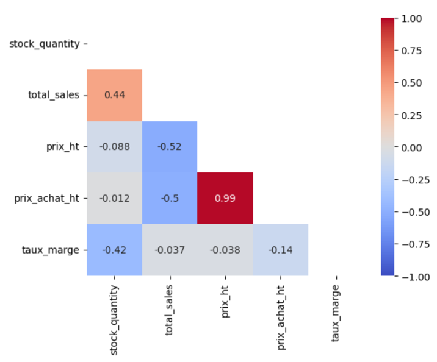

## Context

This project was carried out as part of my Data Analyst training at OpenClassrooms.

## Approach

1. Data cleaning

- Fixing inconsistencies (stock and stock_status)
- Removing outliers and invalid values (negative prices, purchase prices higher than selling prices, duplicates, negative sales, empty rows)
- Handling non-compliant identifiers
- Harmonizing types and formats

2. Consolidation

- ERP - Link table - Web join
- Checking matches between identifiers

3. Analysis

- Total revenue and revenue by product
- Top products and 80/20 analysis
- Outlier detection
- Stock analysis
- Margin analysis
- Correlation matrix

## Key Results

The analysis led to the following conclusions:

- **52%** of products generate 80% of revenue
- Stock value = **2.1 times monthly revenue** => financial risk
- Minimum margin: 55% and maximum margin: **130%** => high

## Key Deliverables

<details>
<summary><b>Correlation heatmap between variables</b></summary>

```python
############################
# Correlation analysis     #
############################

# Create a correlation heatmap with the stock, sales and price variables
df_corr = df_merge[['stock_quantity','total_sales','prix_ht','prix_achat_ht','taux_marge']]
corr = df_corr.corr(method='pearson')
print(corr)
sns.heatmap(corr,cmap='coolwarm',annot=True,vmin=-1,vmax=1)
plt.show()
# A mask can also be created to display only half of the heatmap
ones = np.ones_like(corr) # create an array of 1s with the same shape as the studied df
mask = np.triu(ones,k=0).astype(bool) # replace the lower part of this array 
# with 0s, keeping the diagonal as 1, then convert the 0s and 1s to booleans 
# so that the heatmap can read them
sns.heatmap(corr,cmap='coolwarm',annot=True,vmin=-1,vmax=1,mask=mask) # add the mask to the 
# heatmap. All cells = True are hidden.
plt.show()
```
</details>

{fig-align="center" fig-alt="Half heatmap of correlations between variables"}

## Tech Stack

`python` · `Jupyter`


[View the full project on GitHub →](https://github.com/AniessD/OC_notebook_gestion_donnees_boutique)  
[Back to projects →](../projects.qmd)
