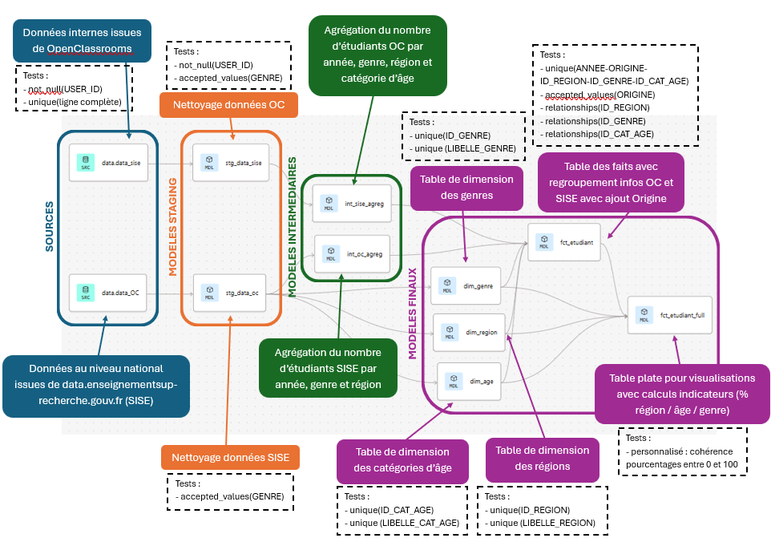

## Context

This project was carried out as part of my Data Analyst training at OpenClassrooms.

## Approach

The project architecture in dbt is as follows:

1. Staging models (stg)
    - Cleaning of source data (OpenClassrooms and national)
    - Standardization of column names

2. Intermediate models (int)

    - Aggregation of data by dimensions

3. Final models (marts)

    - Star schema with a fact table and dimension tables
    - Union of OpenClassrooms and national data
    - Final flat table gathering all the data for visualizations with Looker Studio

## Key Results

Comparing the OpenClassrooms and national populations allowed me to propose 3 recommendations to broaden the student base at OpenClassrooms:

1. Recruit students outside the Île-de-France region by highlighting the benefits of distance learning

2. Move towards a more balanced gender distribution by strengthening recruitment efforts aimed at women

3. Extend recruitment to students in initial education, in addition to the career-changer audience that already makes up the majority

## Key Deliverables

{fig-align="center" fig-alt="Annotated dbt workflow"}

<details>
<summary><b> Query to build the final flat table (SQL)</b></summary>

```sql

{{config(materialized='table')}}

WITH agg_annee_origine_region as (
    SELECT 
        ID_REGION,
        ANNEE,
        ORIGINE,
        sum(NOMBRE_ETUDIANTS) as NOMBRE_ETUDIANTS
    FROM {{ ref('fct_etudiant') }}
    GROUP BY 1,2,3

),

pourcentage_annee_origine_region as (
    SELECT
        ID_REGION,
        ANNEE,
        ORIGINE,
        round(NOMBRE_ETUDIANTS * 100.0 / sum(NOMBRE_ETUDIANTS) OVER (PARTITION BY ANNEE,ORIGINE),2)
        as POURCENTAGE_AO_REGION
FROM agg_annee_origine_region
),

agg_annee_origine_genre as (
    SELECT 
        ID_GENRE,
        ANNEE,
        ORIGINE,
        sum(NOMBRE_ETUDIANTS) as NOMBRE_ETUDIANTS
    FROM {{ ref('fct_etudiant') }}
    GROUP BY 1,2,3

),

pourcentage_annee_origine_genre as (
    SELECT
        ID_GENRE,
        ANNEE,
        ORIGINE,
        round(NOMBRE_ETUDIANTS * 100.0 / sum(NOMBRE_ETUDIANTS) OVER (PARTITION BY ANNEE,ORIGINE),2)
        as POURCENTAGE_AO_GENRE
FROM agg_annee_origine_genre
),

agg_annee_origine_age as (
    SELECT 
        ID_CAT_AGE,
        ANNEE,
        ORIGINE,
        sum(NOMBRE_ETUDIANTS) as NOMBRE_ETUDIANTS
    FROM {{ ref('fct_etudiant') }}
    GROUP BY 1,2,3

),

pourcentage_annee_origine_age as (
    SELECT
        ID_CAT_AGE,
        ANNEE,
        ORIGINE,
        round(NOMBRE_ETUDIANTS * 100.0 / sum(NOMBRE_ETUDIANTS) OVER (PARTITION BY ANNEE,ORIGINE),2)
        as POURCENTAGE_AO_AGE
FROM agg_annee_origine_age
)

SELECT 
    f.ORIGINE,
    f.ANNEE,
    f.ID_REGION,
    r.LIBELLE_REGION,
    f.ID_GENRE,
    g.LIBELLE_GENRE,
    f.ID_CAT_AGE,
    a.LIBELLE_CAT_AGE,
    f.NOMBRE_ETUDIANTS,
    r2.POURCENTAGE_AO_REGION,
    g2.POURCENTAGE_AO_GENRE,
    a2.POURCENTAGE_AO_AGE
FROM {{ ref('fct_etudiant') }} f
    LEFT JOIN {{ ref('dim_age') }} a ON f.ID_CAT_AGE = a.ID_CAT_AGE
    LEFT JOIN {{ ref('dim_genre') }} g ON f.ID_GENRE = g.ID_GENRE
    LEFT JOIN {{ ref('dim_region') }} r ON f.ID_REGION = r.ID_REGION
    LEFT JOIN pourcentage_annee_origine_region r2 ON f.ID_REGION = r2.ID_REGION AND f.ANNEE = r2.ANNEE AND f.ORIGINE = r2.ORIGINE
    LEFT JOIN pourcentage_annee_origine_genre g2 ON f.ID_GENRE = g2.ID_GENRE AND f.ANNEE = g2.ANNEE AND f.ORIGINE = g2.ORIGINE
    LEFT JOIN pourcentage_annee_origine_age a2 ON f.ID_CAT_AGE = a2.ID_CAT_AGE AND f.ANNEE = a2.ANNEE AND f.ORIGINE = a2.ORIGINE
```
</details>

## Tech Stack

`SQL` · `dbt`


[View the full project on GitHub →](https://github.com/AniessD/OC_dbt_profil_socio)  
[Back to projects →](../projects.qmd)
