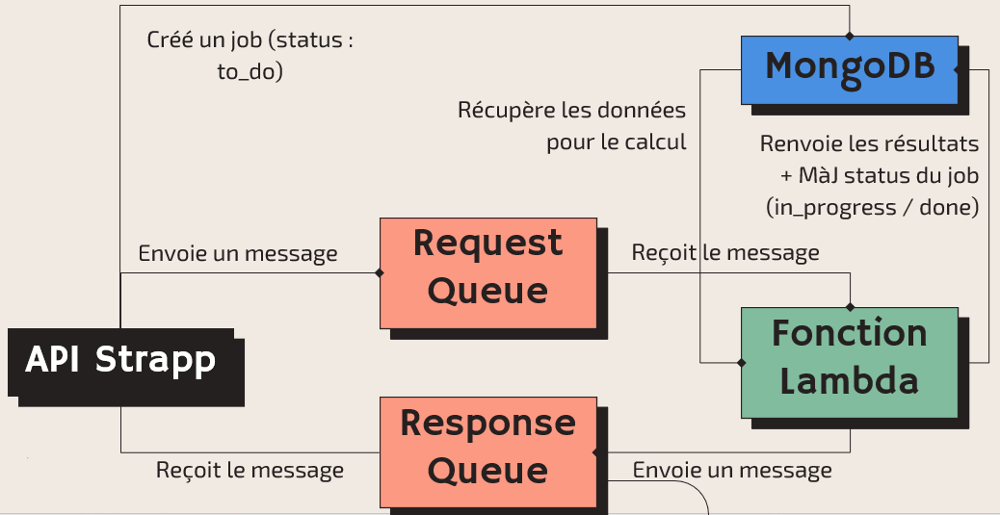
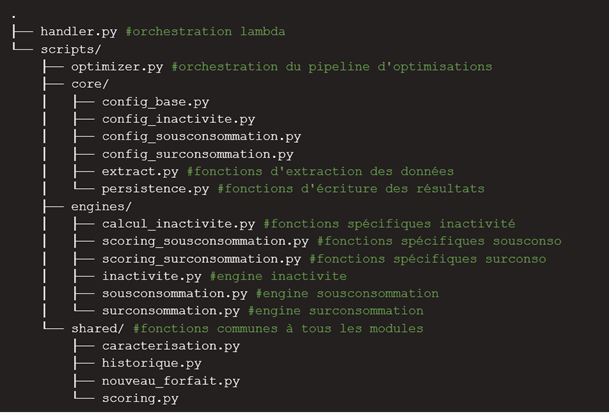

## Context

This project was carried out during a 2-month internship at Strapp Mobile (business mobile fleet management) in Nantes, France.

## Approach

1. Exploratory data analysis

- 3 main topics analyzed:
    - Out-of-plan usage
    - Data overconsumption
    - Data underconsumption
- Initial thoughts on characterizing these situations using criteria:
    - Occasional / Frequent / Regular
    - Number of months / Average frequency / Number of consecutive months

2. Scoring methodology

Development of a scoring algorithm per SIM card to identify usage profiles (overconsumption / underconsumption) and automatically recommend the most suitable plan.

Criteria used for the score:
- Number of months
- Frequency
- Last month
- Overage day (overconsumption)
- Overage proportion (overconsumption)
- Underconsumption proportion (underconsumption)

3. Prototype

Experimentation:
- Jupyter as a lab to validate the scoring method
- Creation of the plan recommendation method, then verification of its consistency

Flexibility:
- All calculation elements are configurable so the algorithm can be adapted to any situation

## Key Results

The project resulted in the delivery of an automated module for analyzing and optimizing mobile plans. Here is how it fits into Strapp Mobile's overall infrastructure:

{fig-align="center" fig-alt="Architecture"}

## Key Deliverables

{fig-align="center" fig-alt="Lambda function"}

<details>
<summary><b> Function calculating the overage day in case of data overconsumption</b></summary>

```python
def calcul_jour_depassement(df_cdr, df_cartessim, dernier_forfait):
    cdr_data = df_cdr.loc[df_cdr['type'] == 'data',['date', 'dataKo', 'iccid']]
    del df_cdr

    # Link with SIM card ids (inner join to exclude unknown iccid)
    sim_iccid = df_cartessim[['_id', 'iccid_text']]
    cdr_data = pd.merge(cdr_data, sim_iccid, left_on='iccid', right_on='iccid_text', how='inner')
    cdr_data = cdr_data[['date', 'dataKo', '_id']]

    # Compute cumulative data consumed per month
    cdr_data = cdr_data.sort_values(['_id', 'date'])
    cdr_data['Mois concerné'] = cdr_data['date'].dt.to_period('M').dt.to_timestamp()
    cdr_data['data_cumsum_ko'] = cdr_data.groupby(['_id', 'Mois concerné'])['dataKo'].cumsum()
    cdr_data.drop(columns='dataKo', inplace=True)
    cdr_data['data_cumsum_go'] = round(cdr_data['data_cumsum_ko'] / config_base.KO_PAR_GO, 2)
    cdr_data.drop(columns='data_cumsum_ko', inplace=True)

    # Link with the plan used (for overconsumption, usage over the whole period is compared to the latest plan, even if the plan changed in the meantime)
    cdr_data = pd.merge(cdr_data, dernier_forfait[['SIM', 'data_go_number']], left_on='_id', right_on='SIM', how='inner')
    cdr_data = cdr_data[['SIM', 'date', 'data_cumsum_go', 'data_go_number']]

    # Flag, then filter rows where cumulative consumption exceeds the plan
    mask = cdr_data['data_cumsum_go'] >= cdr_data['data_go_number'] * config_surconsommation.seuil_surconso
    cdr_data = cdr_data.loc[mask, ['SIM', 'date']]

    # Isolate the day
    cdr_data['jour_depassement'] = cdr_data['date'].dt.day

    # Create overage day df per SIM card (with configured quantile)
    jour_depassement = cdr_data.groupby("SIM")['jour_depassement'].quantile(config_surconsommation.percentile_jour_depassement).reset_index(name="jour_depassement")

    return jour_depassement


```
</details>

## Tech Stack

`python` · `Jupyter` · `AWS`


[Back to projects →](../projects.qmd)
