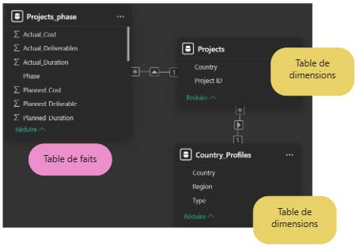

## Context

This project was carried out as part of my Data Analyst training at OpenClassrooms.

## Approach

The dashboard features 6 pages:  

1. Global Performance  

- Overall variance  
- Planned vs. actual bar charts  

2. Projects on Alert  

- List of projects with a variance exceeding 15%  
- Breakdown by indicator  

3. World Map  

- Average delay by country  

4. Project Timeline  

- Project selection from a dropdown list  
- Planned vs. actual project phase visualization  

5. Additional Visualizations  

- Q&A (Natural language querying)  

6. Project Details  

- Detailed project table  
- Dynamic filtering linked to the "Projects on Alert" page  

## Key Results

The analysis led to the following conclusions:  

- The company has an overall performance variance of approximately **2.5%**  
- The performance gap is primarily driven by costs: **€62M** actual vs. **€56M** planned  
- **Egypt** and **Lebanon** exhibit the highest cumulative delays  

## Key Deliverables

{fig-align="center" fig-alt="Snowflake schema"}

<details>
<summary><b> DAX measure calculating the distinct number of projects on alert</b></summary>

```dax
Nb_projets_en_alerte =
CALCULATE(
    DISTINCTCOUNT(Projects[Project ID]),
    Projects[Projets_en_alerte] = "Oui"
)


```
</details>

## Tech Stack

`Power BI` · `DAX` · `Power Query`

[View the full project on GitHub →](https://github.com/AniessD/OC_power_BI_suivi_avancement_projet)  
[Back to projects →](../projects.qmd)
