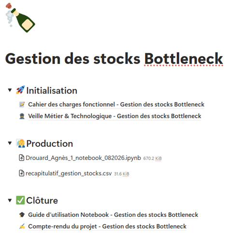

## Context

This project was carried out as part of my Data Analyst training at OpenClassrooms.
It serves as an example of conducting business and technology watch, utilizing a methodology that can be extended to other use cases.

## Approach

The goal was to perform targeted business and technology intelligence to improve an existing project:  
[E-commerce Data Management Optimization.](projet-gestion-boutique.qmd)  
During that initial project, inventory management issues were highlighted. This watch directly addresses that specific need: **Centralize, analyze, and evaluate inventory management methods.**

The workflow is structured as follows:  

### 1. Intelligence Gathering

- Raw watch data is collected via **Feedly** by monitoring various relevant inventory management sources.
- Whenever an article or resource is deemed relevant, it is saved to the *Inventory Management Methods* database with one click using the `Notion Web Clipper` extension.
- The entry automatically lands in the list with the status `To Summarize`.

### 2. Status Tracking

- `To Summarize`: Article captured, pending in-depth reading and note-taking.
- `Summarized`: Method analyzed, with all evaluation fields completed.
- `Not Retained`: Method analyzed but excluded for this project (reasons documented under **Limitations**).

### 3. Processing & Evaluation

Each entry is summarized with the following attributes to evaluate its relevance:  

- **Type**: Indicates whether it is a `Business` method (e.g., Wilson formula) or a `Technology` method (e.g., Python script).
- **Description**: Concise summary of the article explaining the methodology.
- **Implementation Difficulty**: `Low` / `Medium` / `High`, evaluated based on project constraints.
- **Reliability**: `Low` / `Medium` / `High`, evaluated based on project context.
- **Limitations**: Short overview of the method's constraints regarding the project.

## Key Results

The output of this watch is a structured Notion database containing all reviewed sources alongside their potential applications within the project.
This deliverable was integrated into a comprehensive project framing framework, including a functional specification document, a user guide, and a final summary report.

{fig-align="center" fig-alt="Full project summary on Notion"}

## Key Deliverables

---
title: "Business & Technology Watch: Inventory Management Methods"
---

<iframe 
    src="https://cooperative-editorial-60d.notion.site/ebd//3b1fa881b0e6801f9224f7a1aa46023d?v=3b1fa881b0e6801a9b5b000c354c9a0e" 
    title="Business & Technology Watch: Inventory Management Methods"
    width="100%" 
    height="600" 
    style="border: 1px solid var(--border-color); border-radius: 8px;">
</iframe>

## Tech Stack

`Notion` · `Feedly`

[Back to projects →](../projects.qmd)

