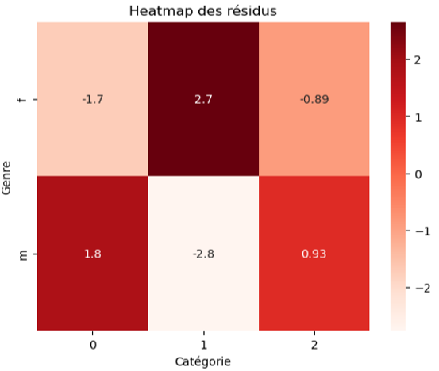

## Context

This project was carried out as part of my Data Analyst training at OpenClassrooms.

## Approach

1. Customer Profiling  

- Identification of a VIP customer segment  
- Gender distribution (52% women / 48% men)  
- Age distribution (over-representation of 18-year-olds => minimum registration age)  

2. Trend Analysis  

- Stable monthly revenue with no marked seasonality  
- Stabilized transaction volume  
- Complete halt in new customer acquisition from February 2022 onwards  

3. Product Performance  

- Identification of 24 unsold products => potential catalog removal  
- Category breakdown (0 = entry-level, 1 = mid-range, 2 = premium)  

4. Customer Behavior  

- Gender vs. Category: Significant association (Chi-Square)  
- Age vs. Total Spending: Weak correlation (Spearman)  
- Age vs. Purchase Frequency: Weak correlation (Spearman)  
- Age vs. Average Basket Size: Moderate correlation (Spearman)  
- Age vs. Category: Significant association (Kruskal-Wallis)  

## Key Results

The analysis yielded the following strategic recommendations:  

- Target women aged 35–55 with category 1 (mid-range) products  
- Develop targeted offerings for 20–30-year-olds with premium products  
- Optimize the product catalog (remove unsold or low-performing items)  
- Relaunch customer acquisition campaigns  

## Key Deliverables

<details>
<summary><b> Chi-Square Test of Independence: Gender vs. Product Categories</b></summary>

```python
# Compute Chi-Square test
chi2_stat, p_value, dof, expected = chi2_contingency(contingency_table)

# Hypothesis H0: Variables are independent
# Hypothesis H1: Variables are dependent
# Significance threshold
threshold = 0.05

print(f"Chi-Square Statistic: {round(chi2_stat, 2)}")
print(f"p-value: {p_value}")
if p_value < threshold:
    print("The p-value is below the threshold: H0 is rejected. The relationship between gender and category is statistically significant.")
else:
    print("The p-value is above the threshold: H0 is not rejected.")

```
</details>

::: {.callout-tip title="Execution output"}
Chi-Square Statistic: **22.67**   
p-value: **1.1955928116587024e-05**  
The p-value is **below** the selected threshold: H0 is rejected, and the relationship between gender and product category is **statistically significant**.

:::

{fig-align="center" fig-alt="Residuals Heatmap - Gender and Product Categories"}

## Tech Stack

`python` · `Jupyter`


[View the full project on GitHub →](https://github.com/AniessD/OC_notebook_vente_librairie)  
[Back to projects →](../projects.qmd)
