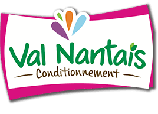

---
title: "À propos"
description-meta: "Data analyst freelance à Nantes. Analyse exploratoire, dashboards Power BI, modélisation décisionnelle."
---

:::: {.columns}

::: {.column width="30%"}
{.rounded-circle fig-alt="Photo d'Agnès Drouard" width="100%"}
:::

::: {.column width="5%"}
<!-- Espace de séparation -->
:::

::: {.column width="65%"}
Agnès Drouard

## Qui je suis

Data Analyst spécialisée dans l'industrie, avec 10 ans d'expérience en supply chain et en qualité (approvisionnement, ordonnancement, traçabilité, risques matières premières), je transforme vos données de production et de logistique en outils de pilotage fiables.
:::

::::

Pour les avoir rencontrées, je connais bien les problématiques métiers. J'ai notamment construit et automatisé des bases de données de risques sur les matières premières ou encore mis en place des KPI côté supply chain (approvisionnement et ordonnancement d’une dizaine d’usines).

## Me contacter

Un projet d'analyse de données, une question sur mes réalisations ou une opportunité de collaboration ?

::: {.callout-note appearance="minimal"}
<i class="bi bi-geo-alt-fill"></i> Nantes & Remote  
<i class="bi bi-envelope-fill"></i> [agnesdrouard90@gmail.com](mailto:agnesdrouard90@gmail.com)  
<i class="bi bi-linkedin"></i> [LinkedIn](https://www.linkedin.com/in/agnes-drouard/)  
<i class="bi bi-github"></i> [GitHub](https://github.com/AniessD)  
<svg xmlns="http://www.w3.org/2000/svg" width="16" height="16" fill="currentColor" viewBox="0 0 24 24" style="vertical-align: -0.125em;">
  <path d="M12 0L1.5 6v12L12 24l10.5-6V6L12 0zm0 3.21l7.5 4.29v8.57L12 20.36l-7.5-4.29V7.5L12 3.21z"/>
</svg> [Malt](https://www.malt.fr/profile/agnesdrouard)
:::

## Compétences

- **Transformation** : SQL, DBT, Snowflake
- **BI** : Power BI, Power Query, DAX
- **Analyse et automatisation** : Python (Pandas, NumPy, Matplotlib), Jupyter, Excel (avancé, TCD, VBA)
- **Cloud et versioning** : AWS (Lambda, SQS), Git

## Expériences professionnelles

::: {.mb-5}
::: {.d-flex .align-items-center .gap-3 .mb-1}
{width="55px" fig-alt="Logo Strapp Mobile" .my-auto}

::: {.d-flex .flex-column .justify-content-center}
### Data Analyst - Strapp Mobile {.h4 .m-0 .fw-bold .lh-1}
[*Stage · mars 2026 - avril 2026*]{.text-muted .mt-1 .mb-0 .fs-6 .lh-1}
:::
:::

- **Modélisation statistique & scoring (Jupyter) :** Méthodologie de calcul multicritères (AHP) pour scorer les consommations data et automatiser les recommandations de forfaits.
- **Industrialisation (AWS) :** Scripts Python (GitLab) connectés à MongoDB pour automatiser le traitement via Lambda et SQS.
:::

::: {.mb-5}
::: {.d-flex .align-items-center .gap-3 .mb-1}
{width="55px" fig-alt="Logo Val Nantais" .my-auto}

::: {.d-flex .flex-column .justify-content-center}
### Responsable approvisionnement - Val Nantais {.h4 .m-0 .fw-bold .lh-1}
[*CDI · juillet 2024 - novembre 2024*]{.text-muted .mt-1 .mb-0 .fs-6 .lh-1}
:::
:::

- Analyse des besoins d’approvisionnement et modélisation des plannings en fonction des contraintes contractuelles et opérationnelles
- Suivi des indicateurs de performance (délais, litiges, coûts)
- Coordination des flux (transport, emballages) et achats hors contrat
:::

::: {.mb-5}
::: {.d-flex .align-items-center .gap-3 .mb-1}
{width="55px" fig-alt="Logo Eurial" .my-auto}

::: {.d-flex .flex-column .justify-content-center}
### Responsable ordonnancement - Eurial {.h4 .m-0 .fw-bold .lh-1}
[*CDI · février 2021 - juin 2024*]{.text-muted .mt-1 .mb-0 .fs-6 .lh-1}
:::
:::

- Indicateur de performance d’approvisionnement et modélisation de scénarios d’optimisation
- Mise en place et suivi des indicateurs de performance d’ordonnancement pour piloter l’activité au quotidien
- Construction et suivi du programme hebdomadaire d’approvisionnement (analyse des volumes, contraintes, écarts)
:::

::: {.mb-5}
::: {.d-flex .align-items-center .gap-3 .mb-1}
{width="55px" fig-alt="Logo LDC" .my-auto}

::: {.d-flex .flex-column .justify-content-center}
### Assistante Qualité - LDC Traiteur {.h4 .m-0 .fw-bold .lh-1}
[*CDI · octobre 2014 - avril 2019*]{.text-muted .mt-1 .mb-0 .fs-6 .lh-1}
:::
:::

- Construction et automatisation (VBA) des bases de données risques matières premières
- Cadrage fonctionnel et tests du logiciel interne de gestion des matières premières
- Gestion des données fournisseurs et matières premières
:::

## Certifications

::: {.mb-4}
::: {.d-flex .align-items-center .gap-3 .mb-1}
{width="55px" fig-alt="Logo Microsoft" .my-auto}

::: {.d-flex .flex-column .justify-content-center}
### [Microsoft Certified: Power BI Data Analyst Associate (PL-300)](https://learn.microsoft.com/api/credentials/share/fr-fr/AgnsDrouard-7394/E4DED5AC3B472D3B?sharingId=D6319BD3198A0AAA) {.h4 .m-0 .fw-bold .lh-1}
[*Microsoft · juin 2026*]{.text-muted .mt-1 .mb-0 .fs-6 .lh-1}
:::
:::
:::

::: {.mb-4}
::: {.d-flex .align-items-center .gap-3 .mb-1}
{width="55px" fig-alt="Logo OpenClassrooms" .my-auto}

::: {.d-flex .flex-column .justify-content-center}
### Data Analyst, titre RNCP niveau 6 (équivalent bac+3/4) {.h4 .m-0 .fw-bold .lh-1}
[*OpenClassrooms · septembre 2026*]{.text-muted .mt-1 .mb-0 .fs-6 .lh-1}
:::
:::
:::

## Recommandations

::: {.callout-note appearance="minimal"}
J'ai eu le plaisir de travailler plusieurs années avec Agnès au sein de l'équipe Qualité, qu'elle a rejointe comme jeune ingénieure.  
Très à l'aise avec les outils informatiques, elle est rapidement devenue la référence de l'équipe sur ces sujets. Elle a développé et fait évoluer de nombreux outils applicatifs qualité, en partant toujours des besoins concrets des utilisateurs.  
Elle a joué un rôle clé dans la mise en place et le déploiement de notre plateforme de gestion des cahiers des charges fournisseurs. Ce projet a permis de connecter l'ensemble de nos fournisseurs et de consolider les cahiers des charges sur un modèle dédié à chaque famille de produits. Sur ce chantier de structuration de données, exigeant et sur plusieurs années, j'ai pu compter sur elle du début à la fin.  
Rigoureuse, pragmatique et à l'écoute, Agnès sait comprendre un métier avant de proposer une solution. C'est une professionnelle fiable et de confiance.  
Je suis ravie de la voir se lancer en freelance comme Data Analyst. Je la recommande sans hésiter !  

**Alexandra VANHUYSBERGHE** - *Reponsable directe chez LDC Traiteur*
:::

::: {.callout-note appearance="minimal"}
J'ai eu le plaisir de manager Agnès pendant plus de 3 ans chez Eurial.  
Grâce à sa très bonne maîtrise des enjeux d'approvisionnement et sa rigueur d'analyse, elle a notamment développé des indicateurs de performance pour le service et modélisé des scénarios d'optimisation clés pour notre activité. Agnès a une capacité à jongler entre la gestion opérationnelle du quotidien et la prise de hauteur nécessaire pour construire des outils de pilotage fiables et durables.  
 Je recommande Agnès pour toute mission d'analyse de données et d'optimisation de processus.

**Jérôme TOMASZEWSKI** - *Reponsable directe chez Eurial*
:::

::: {.callout-note appearance="minimal"}
J'ai eu le plaisir de travailler avec Agnès au sein d'Eurial, j'ai pu apprécier son excellent travail, sa rigueur, sa curiosité et sa facilité à traiter les problèmes.  
C'est donc avec confiance que je recommande Agnès, vous pourrez bénéficier de son expérience, de ses qualités de vraie professionnelle, alors n'hésitez pas, contactez là !  

**Stéphane LEMESLE** - *Reponsable directe chez Eurial*
:::

---

